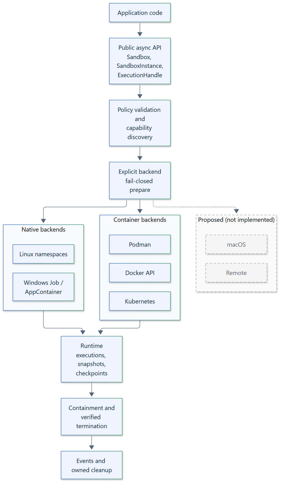

<p align="center">
  
</p>

<h1 align="center">Isolattice</h1>

<p align="center">
  
  
  
  
  <a href="https://github.com/smuniharish/isolattice/blob/main/LICENSE"></a>
</p>

**Run commands and generated code from async Python, under policies that are
enforced or refused, never quietly weakened.**

Isolattice is an asynchronous sandbox execution framework. You state the
guarantees a workload needs: no network, a read-only root, 256 MiB of memory,
at most 32 processes, a 30-second timeout. Isolattice asks the backend what it
can actually enforce on this host, refuses the request if a required guarantee
is missing, runs the workload, and verifies that its whole process tree is
gone before reporting it stopped. The same typed API drives Podman, the Docker
API, Kubernetes, Linux namespaces, Windows AppContainer and Windows Job
Objects.

<p align="center">
  
</p>

> [!IMPORTANT]
> Containers, Pods, Linux namespaces and AppContainers share the host (or node)
> kernel, so kernel, engine, runtime or cluster exploits are outside the threat
> model. Windows Job Objects provide containment and resource control only;
> they are not a security boundary. See the [guarantees](https://isolattice.readthedocs.io/en/latest/security/guarantees/).

## Why Isolattice

An application has to run code it didn't write: a user's report script, a
tool call from an LLM agent, a build step, a grader for submitted exercises.
The usual options each leave a gap:

- **`subprocess` and `asyncio.create_subprocess_exec` isolate nothing.** The
  child has your files, your network and your credentials. Killing the child
  leaves its grandchildren running, and a timeout doesn't bound memory or
  output.
- **Calling `docker run` or `podman run` yourself is easy to get subtly
  wrong.** A missing flag silently grants network access, a resource limit is
  ignored on a host without delegated cgroups, and a cancelled request leaks a
  container nobody owns.
- **Every platform enforces isolation differently.** Linux has namespaces,
  cgroups, seccomp and Landlock; Windows has Job Objects and AppContainers;
  Kubernetes has Pods. Code written for one doesn't move to another, and their
  guarantees aren't equal.
- **Wrappers that promise "secure execution" rarely say what they don't
  enforce.** When a limit can't be applied, the run goes ahead anyway.

How Isolattice addresses each one:

| Problem | What Isolattice does |
| --- | --- |
| No isolation from `subprocess` | Runs each workload inside a backend boundary: a container, a namespace set, a Pod or an AppContainer, with no network and a read-only root by default |
| Engine flags are easy to get wrong | Builds every engine call itself from a typed `SandboxPolicy`, owns every resource it creates, and cleans up by identity on success, error and cancellation |
| Platforms differ | One async API; each backend reports what it enforces on this host as supported, limited or unsupported, with evidence |
| Limits silently ignored | Required capabilities and requested budgets fail closed with `SandboxCapabilityError` before anything runs |
| Orphaned processes | Termination is verified against the boundary, not the direct child; an unverified stop raises `TerminationVerificationError` instead of reporting success |

Isolattice doesn't replace a container engine, an orchestrator or a virtual
machine. It drives them through one policy model, and is explicit about the
guarantees each one does and doesn't give you.

## Highlights

- **Async-only lifecycle.** Create, run, stream, cancel, stop and close are
  `async`; a sandbox and its instances are async context managers that clean
  up on errors and cancellation.
- **Fail-closed policies.** Network access, root writability, memory, CPU,
  process count, scratch space, instance-wide budgets and timeouts are
  enforced or refused. Nothing is downgraded quietly.
- **Capability discovery with evidence.** `Sandbox.discover()` reports each
  capability's state on the current host and why.
- **Verified termination.** Graceful stop, forced kill, retries and a cleanup
  deadline; cleanup that outlives the deadline stays owned and is reported.
- **Bounded output.** Streamed stdout and stderr with per-stream limits and
  truncation flags.
- **Snapshots and checkpoints.** Workspace snapshots on every native backend
  and Podman, whole-container snapshots, and CRIU checkpoints on rootful
  Podman, stored with SHA-256 manifests verified on every read.
- **Extensible through ABCs.** Bring your own `ArtifactStore`, `EventSink`,
  `CommandRunner` or `Backend`. A local store is built in and an S3 store is an
  optional extra.
- **Small and typed.** The core has no runtime dependencies, ships type hints
  and supports Python 3.12 to 3.15.

## Backends

| Backend | Boundary | Live-tested on |
| --- | --- | --- |
| `PodmanBackend` | One restricted container per execution; rootless by default | Podman machine, rootless and rootful |
| `DockerBackend` | One restricted container per execution through the Docker Engine API | Podman's Docker-compatible API |
| `KubernetesBackend` | One owned Pod per execution in an explicit namespace; no network isolation | Single-node kind cluster |
| `LinuxNamespaceBackend` | User, PID, mount, network, IPC and UTS namespaces, delegated cgroup v2, seccomp and Landlock | WSL 2 with a delegated systemd scope |
| `WindowsAppContainerBackend` | Less-privileged AppContainer inside nested Job Objects; no network | Windows 11 |
| `WindowsJobBackend` | Job Object containment and budgets. **Not a security boundary:** files, network and registry stay reachable | Windows 11 |

A macOS backend and remote execution are proposed and not implemented. The
[platform limitations](https://isolattice.readthedocs.io/en/latest/security/platform-limitations/)
page lists what each backend doesn't enforce.

## Installation

```bash
pip install isolattice           # core, no dependencies
pip install "isolattice[s3]"     # adds S3ArtifactStore (aiobotocore)
```

Container backends need their engine client: `podman`, a Docker API endpoint,
or `kubectl` with a kubeconfig. The Windows backends need nothing else. The
Linux backend needs a delegated cgroup v2 subtree.

## Quickstart

Run a command on a rootless Podman connection, with no network, a read-only
root, and memory and process limits that must be enforced:

```python
import asyncio

from isolattice import Capability, ExecutionRequest, PodmanBackend, Sandbox, SandboxPolicy


async def main() -> None:
    backend = PodmanBackend(
        connection="podman-machine-default", image="docker.io/library/alpine:3.22"
    )
    policy = SandboxPolicy(
        memory_bytes=128 * 1024 * 1024,
        process_limit=32,
        required_capabilities=(Capability.MEMORY_LIMIT, Capability.PROCESS_LIMIT),
    )
    request = ExecutionRequest(
        argv=(
            "/bin/sh",
            "-c",
            "echo hello from $(hostname); wget -q -T 2 -O- http://example.com || echo network: blocked",
        ),
        timeout=10,
    )
    async with Sandbox(backend=backend) as sandbox, await sandbox.create(policy=policy) as instance:
        result = await instance.run(request)
    print(result.stdout.decode(), end="")
    print("exit code:", result.exit_code)
    print("termination:", result.termination.state)


asyncio.run(main())
```

On a connection with delegated cgroup controllers:

```text
hello from 33a5a6dd24ba
network: blocked
exit code: 0
termination: terminated
```

On a connection without them, nothing runs:

```text
isolattice.errors.SandboxCapabilityError: resource limits require delegated controllers: memory, pids
```

Isolattice never pulls images; the image must already be present on the
connection. A Podman workload sees only the environment you pass, with no `PATH`,
to name executables by absolute path. The
[quickstart](https://isolattice.readthedocs.io/en/latest/getting-started/quickstart/)
covers streaming output, cancellation and the other backends.

### Your own storage, events and tooling

Every extension point is an abstract base class, passed in explicitly.
Nothing is discovered or loaded implicitly:

```python
from isolattice import LoggingEventSink, S3ArtifactStore, Sandbox

store = S3ArtifactStore(bucket="sandbox-artifacts", prefix="team-a/")
sandbox = Sandbox(backend=backend, artifact_store=store, event_sink=LoggingEventSink())
```

- **`ArtifactStore`** keeps workspace snapshots, container snapshots and
  checkpoints. Isolattice computes and verifies the integrity manifest, so a
  store never has to vouch for its own data.
  `isolattice.testing.check_artifact_store` checks a custom store against the
  contract.
- **`EventSink`** receives typed lifecycle events, never workload output or
  secrets.
- **`CommandRunner`** controls how `podman`, `docker` and `kubectl` are
  started, for auditing or tracing.
- **`Backend`**, **`BackendSession`** and **`TerminationDriver`** add a new
  isolation technology.

A package built on Isolattice can pass each of these through to its own users.
See [custom integrations](https://isolattice.readthedocs.io/en/latest/guides/custom-integrations/)
and [custom backends](https://isolattice.readthedocs.io/en/latest/guides/custom-backend/).

## Examples

Runnable programs in
[`examples/`](https://github.com/smuniharish/isolattice/tree/main/examples),
each exercised by a live test on a real host:

- [First sandbox on Podman](https://github.com/smuniharish/isolattice/blob/main/examples/01-getting-started/podman_hello.py)
- [Resource limits and instance budgets](https://github.com/smuniharish/isolattice/tree/main/examples/04-resource-management)
- [Streaming and cancellation](https://github.com/smuniharish/isolattice/blob/main/examples/06-async-and-cancellation/podman_stream_cancel.py)
- [Linux namespaces and Windows AppContainer](https://github.com/smuniharish/isolattice/tree/main/examples/08-native-backends)
- [Docker API](https://github.com/smuniharish/isolattice/blob/main/examples/09-container-integrations/docker_isolated_run.py)
  and [Kubernetes](https://github.com/smuniharish/isolattice/blob/main/examples/10-kubernetes/kubernetes_isolated_run.py)
- [Workspace and container snapshots](https://github.com/smuniharish/isolattice/tree/main/examples/12-snapshots)
- [CRIU checkpoints](https://github.com/smuniharish/isolattice/blob/main/examples/13-checkpoints/podman_checkpoint.py)
- [Failure handling](https://github.com/smuniharish/isolattice/blob/main/examples/18-failure-scenarios/podman_failures.py)

## Documentation

Full documentation: **[isolattice.readthedocs.io](https://isolattice.readthedocs.io/en/latest/)**

- [Getting started](https://isolattice.readthedocs.io/en/latest/getting-started/)
- [Concepts](https://isolattice.readthedocs.io/en/latest/concepts/introduction/)
- [Backends](https://isolattice.readthedocs.io/en/latest/backends/podman/)
- [Security model and guarantees](https://isolattice.readthedocs.io/en/latest/security/guarantees/)
- [Architecture](https://isolattice.readthedocs.io/en/latest/architecture/02-architecture-overview/)
- [API reference](https://isolattice.readthedocs.io/en/latest/api/)

Two [Agent Skills](https://isolattice.readthedocs.io/en/latest/agent-skills/)
teach coding agents such as Claude Code, Codex, Cursor and GitHub Copilot to
use Isolattice correctly. `isolattice` moves command execution onto a backend
with a fail-closed policy, and `isolattice-extend` writes stores, event sinks,
runners and backends:

```bash
npx skills add smuniharish/isolattice
```

Changes are listed in the
[changelog](https://github.com/smuniharish/isolattice/blob/main/CHANGELOG.md).

## Contributing

Contributions are welcome. See
[CONTRIBUTING.md](https://github.com/smuniharish/isolattice/blob/main/CONTRIBUTING.md)
for the development setup and checks, and
[SECURITY.md](https://github.com/smuniharish/isolattice/blob/main/SECURITY.md)
to report a vulnerability.

## License

Apache License 2.0. See
[LICENSE](https://github.com/smuniharish/isolattice/blob/main/LICENSE).
