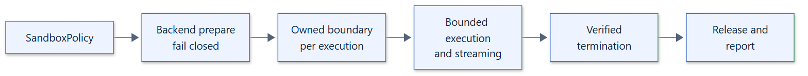

# 01. Project overview

## Purpose

Isolattice is a Python 3.12+ library (Apache-2.0, version 0.1.0) that gives async
applications one explicit interface to create an execution boundary, run workloads
inside it, stream bounded output, and verify that the boundary is empty and released
afterwards. The common API does not imply equal protection: each backend enforces
what its platform can, reports it as capability evidence, and rejects policies it
cannot enforce.

!!! warning "Shared-kernel backends"
    Container, namespace and AppContainer backends share the host or node kernel,
    so kernel, engine, runtime and cluster exploits are outside the threat model.
    The Windows Job Object backend is containment only, not a security boundary.
    A backend is always selected explicitly by constructing it.

## Current state

| Area | Status |
| --- | --- |
| Async runtime: `Sandbox`, `SandboxInstance`, `ExecutionHandle` | Implemented |
| Capability discovery with evidence; fail-closed required capabilities | Implemented |
| Bounded stdout/stderr streaming, truncation flags, timeouts, cancellation | Implemented |
| Verified, identity-based termination with a hard `cleanup_deadline` | Implemented |
| Linux namespace, Windows Job Object and Windows AppContainer backends | Implemented |
| Podman, Docker API and Kubernetes Pod backends | Implemented |
| Per-execution memory, CPU and process limits; instance budgets; scratch limits | Implemented, backend-dependent |
| Persistent workspaces and workspace snapshots | Implemented: Linux, AppContainer, Podman |
| CRIU execution checkpoints and restore | Implemented: rootful Podman only |
| Whole-container snapshots | Implemented: Podman |
| Artifact stores (local, S3), event sinks, command runners | Implemented |
| macOS hosts through the container backends | Implemented; core suite tested in CI |
| Remote engines through Podman `ssh://`, Docker hosts or kubeconfig contexts | Implemented; Podman over SSH tested in CI |
| Native macOS backend | Proposed; Seatbelt evaluation only |
| Isolattice remote service and remote execution protocol | Proposed |
| Framework integrations | Proposed |
| OpenTelemetry and metrics exporters | Proposed; write an `EventSink` today |

Per-feature evidence is tracked in the [feature coverage](../development/feature-coverage.md)
ledger; the per-backend capability matrix is in the
[capabilities reference](../reference/capabilities.md).

## Scope

- Public execution and lifecycle operations are `async`. Configuration objects and
  reports are immutable and synchronous to construct and read.
- The core package has no runtime dependencies and imports without a daemon,
  container engine or cluster. Only the optional `s3` extra adds a dependency.
- An unavailable required guarantee makes creation fail. There is no subprocess or
  cross-backend fallback.
- Isolattice is not a container engine, scheduler, hypervisor or protection against
  a compromised host kernel, engine or cluster.

## Delivery contract

A feature counts as implemented only with a typed API, documentation, unit tests, a
runnable example and live evidence on a real kernel, engine or cluster. A mock tests
protocol behavior only, and a skipped live test is not evidence. Pages label features
as **Implemented** or **Proposed**; documentation never presents a
proposed feature as available.

## Trade-offs

Fail-closed preparation can leave a backend unusable on a host without user
namespaces, cgroup delegation or the required engine features. This is deliberate:
a weaker boundary is never substituted silently. Hostile multi-tenant workloads need
a VM or microVM boundary; shared-kernel backends cannot promise that strength.

See the [architecture overview](02-architecture-overview.md) and the
[architecture decisions](22-architecture-decision-records.md).
