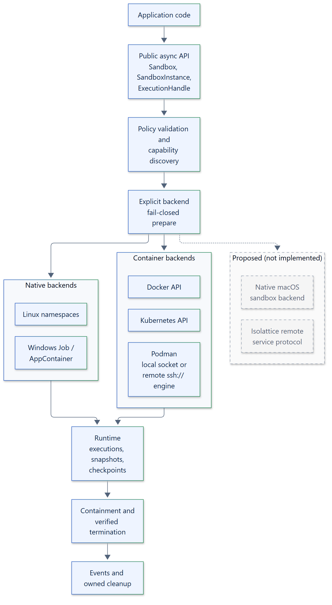

# 02. Architecture overview

## Layers

Application code depends on a small async facade and immutable models. The core owns
policy validation, lifecycle coordination, output bounds, deadlines, artifact
integrity and error composition. Backends own enforcement and boundary observation.

Podman connections may point at a local socket or a remote engine over `ssh://`. A
native macOS sandbox backend and an Isolattice remote service protocol are proposed
and not implemented; they appear dashed. macOS hosts use the container backends.

## Modules

| Module | Responsibility |
| --- | --- |
| `isolattice.runtime` | `Sandbox`, `SandboxInstance` and `ExecutionHandle`: ownership, admission, streaming, deadlines, cleanup |
| `isolattice.models` | Frozen policies, requests, results, capability reports and artifact manifests |
| `isolattice.backend` | `Backend`, `BackendSession` and `Boundary`: the backend extension contract |
| `isolattice.backends` | The six built-in backends |
| `isolattice.termination` | `TerminationDriver` and `terminate_boundary()`: verified stop, observe, escalate and release |
| `isolattice.commands` | `CommandRunner` and `SubprocessRunner`: how container backends start engine clients |
| `isolattice.storage`, `isolattice.s3` | `ArtifactStore`, `LocalArtifactStore` and `S3ArtifactStore` |
| `isolattice.events` | `EventSink`, `LoggingEventSink`, `SandboxEvent` and `EventKind` |
| `isolattice.errors` | The exception hierarchy |
| `isolattice.testing` | `check_artifact_store()` conformance check |

## Dependency direction

Models and errors are leaf modules. The runtime depends on the abstract `Backend`,
`BackendSession`, `ArtifactStore` and `EventSink` classes, never on a concrete
backend. Built-in backends bind Windows APIs only on Windows, and `aiobotocore` is
imported only when an `S3ArtifactStore` first talks to S3, so importing `isolattice`
needs no optional package and never contacts an engine. Every
extension point is an abstract base class passed explicitly to its owner; nothing is
discovered through entry points or global registries.

## Creation transaction

`Sandbox.create(policy=...)` validates arguments, then calls
`Backend.prepare(policy, sandbox_id)`. The backend checks the policy settings it
supports and every required capability, and allocates
instance-wide resources such as a workspace or an instance budget. Optional
workspace and container snapshots are fetched, verified and imported. Only then is a
`SandboxInstance` returned in the `ready` state. If any step fails, the session is
closed and both the original failure and any cleanup failure are raised together.

## Execution and cleanup

Each execution gets its own boundary. The runtime asks the session to allocate and
register the boundary, starts it, drains both output streams concurrently with
bounded captures, and always terminates the boundary through the backend, whether the
workload exited, timed out, was cancelled or was stopped. See the
[lifecycle](09-lifecycle-state-machine.md) and the
[termination engine](11-termination-engine.md).

## Ownership

- `Sandbox` owns one backend, the optional artifact store and event sink, and every
  instance it created. Closing it closes each instance.
- `SandboxInstance` owns its `BackendSession`, its active executions and any late
  cleanup still running after a deadline.
- `ExecutionHandle` owns its boundary, its output queue and its cleanup task.

Cleanup runs in owned tasks that survive repeated caller cancellation; cancellation
of a waiter is reported after cleanup completes or its deadline expires. One service
belongs to one event loop.

## Failure handling

A backend outage or failed observation yields an `unknown` termination state, never
success. Discovery is evidence, not enforcement: `prepare` and boundary setup verify
the actual configuration again before any workload runs.
