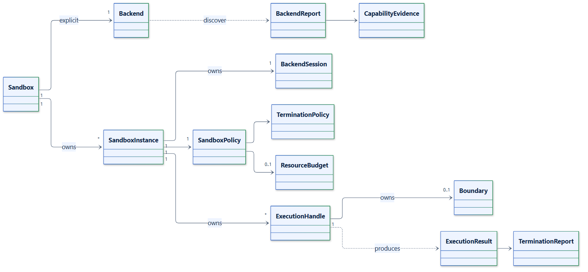

# 04. Domain model

## Model

| Concept | Type | Role |
| --- | --- | --- |
| Service | `Sandbox` | Owns one explicit `Backend`, an optional `ArtifactStore` and `EventSink`, and its instances |
| Instance | `SandboxInstance` | One prepared `BackendSession` with an immutable `SandboxPolicy`; identified by `sandbox_id` |
| Execution | `ExecutionHandle` | One workload in its own boundary; identified by `execution_id` |
| Boundary | `Boundary` | The backend's containment unit: `boundary_id`, `name`, owning IDs, `start_requested`, `restore_source` |
| Policy | `SandboxPolicy`, `TerminationPolicy`, `ResourceBudget`, `NetworkAccess` | Requested guarantees, limits, deadlines and output bounds |
| Request | `ExecutionRequest` | `argv`, `stdin`, `environment`, `cwd`, `timeout` |
| Result | `ExecutionResult`, `OutputChunk` | Exit code, bounded captures, truncation flags, duration and the termination report |
| Capability | `Capability`, `CapabilityState`, `CapabilityEvidence`, `BackendReport` | What a backend reports it can enforce, with evidence and limitations |
| Termination | `TerminationReport`, `Observation`, `BoundaryState` | What cleanup observed and whether resources were released |
| Artifact | `ArtifactManifest`, `ArtifactKind` | A workspace snapshot, execution checkpoint or container snapshot and its digest |
| Event | `SandboxEvent`, `EventKind` | A redacted lifecycle record for operators |

## Identity

- `sandbox_id` and `execution_id` are random UUID4 hex strings created by the
  runtime.
- `boundary_id` is the backend's authoritative handle: a container or Pod name with
  a UID precondition, a cgroup path, or a Job Object. Every termination decision is
  made against this identity.
- A PID, process name or direct-child exit is never treated as boundary identity;
  PIDs are reused and descendants can outlive their parent.
- Artifact keys are portable, slash-separated names validated by
  `validate_artifact_key()`; the manifest records the producing backend and format.

## Invariants

- Policies, requests, results, reports, manifests and events are frozen dataclasses
  validated on construction. Mappings are exposed read-only.
- Every execution has exactly one boundary, and every boundary has a termination
  report once cleanup finishes or its deadline expires.
- A `TerminationReport` with state `terminated` means the boundary was observed
  empty twice and its resources were removed. `non_empty` and `unknown` are failures.
- Events and reports never contain argv, environment values, stdin or output.
