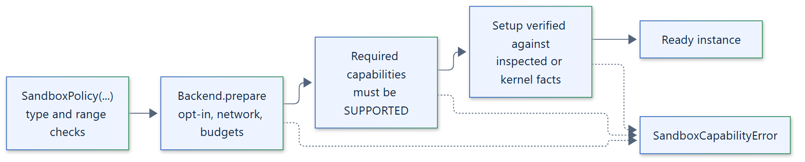

# 05. Policy model

## Policy

`SandboxPolicy` states what an instance must enforce. Backends either enforce each
setting or reject the policy in `prepare()` with `SandboxCapabilityError`; nothing is
downgraded silently.

| Field | Default | Meaning |
| --- | --- | --- |
| `network` | `NONE` | `NONE`, `ENABLED` or `ALLOWLIST` |
| `read_only_root` | `True` | Read-only root filesystem |
| `memory_bytes`, `cpu_cores`, `process_limit` | `None` | Per-execution limits |
| `instance_budget` | `None` | A `ResourceBudget` shared by all executions of the instance |
| `scratch_bytes` | `None` | Size of the writable scratch area |
| `workspace` | `False` | Persistent workspace shared by executions; enables workspace snapshots |
| `required_capabilities` | `()` | Capabilities that must be `SUPPORTED`, or the instance is not created |
| `execution_timeout` | `30.0` | Default deadline per execution, overridable per request |
| `max_concurrent_executions` | `4` | Admission limit per instance |
| `output_queue_chunks` | `16` | Streaming queue depth for `output()` |
| `stdout_limit`, `stderr_limit` | `1048576` | Capture bounds in bytes |
| `termination` | `TerminationPolicy()` | Cleanup timing; see the [termination engine](11-termination-engine.md) |

## Acknowledgements

Some backends cannot enforce a default. Rather than weaken it, they require the
policy to state the weaker setting explicitly:

- Windows Job Object and Kubernetes require `network=ENABLED`, because they do not
  isolate the network. Linux, AppContainer, Podman and Docker accept only
  `network=NONE`. `ALLOWLIST` is rejected by every built-in backend.
- Windows Job Object requires `read_only_root=False`; AppContainer requires
  `read_only_root=True`; Docker and Kubernetes reject a writable root.
- Backends that cannot provide a workspace, scratch limit or instance budget reject
  those settings. The [capabilities reference](../reference/capabilities.md) lists
  each combination.

## Required capabilities

A capability listed in `required_capabilities` must be reported as `SUPPORTED`. The
single exception is Podman, which accepts `CHECKPOINTS` at `LIMITED` and then runs a
live CRIU probe before the instance is returned. Required checks run in `prepare()`
against the live environment, not against cached discovery output.

## Validation

Invalid values raise `TypeError` or `ValueError` on construction: wrong types,
non-positive or non-finite limits and timeouts, a `ResourceBudget` without any
limit, or non-`Capability` entries. Requiring `INSTANCE_LIMITS`, `DISK_LIMIT`,
`WORKSPACE` or `SNAPSHOTS` without the matching policy setting (`instance_budget`,
`scratch_bytes`, `workspace`, or a workspace or writable root) is a `ValueError`.
Policies are immutable; a different policy needs a new instance.

See the [policy reference](../reference/policies.md).
