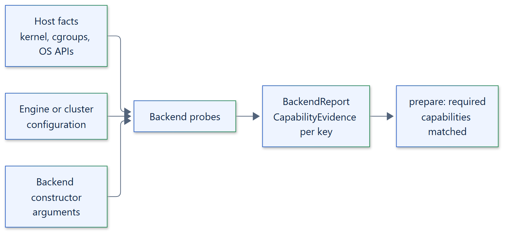

# 06. Capability model

## Capabilities

A backend describes what it can enforce through `Backend.discover()`, which returns a
`BackendReport`: `name`, `available`, a mapping from `Capability` to
`CapabilityEvidence(state, detail)`, `limitations` and an optional `error`.
`Sandbox.discover()` returns the report of its single backend as a one-element tuple.

| Capability | Meaning |
| --- | --- |
| `FILESYSTEM_ISOLATION` | The workload sees only its own or read-only host paths |
| `NETWORK_ISOLATION` | No network access beyond loopback |
| `PROCESS_ISOLATION` | The workload cannot see or signal host processes |
| `VERIFIED_TERMINATION` | Boundary emptiness and release are observed through its identity |
| `ENVIRONMENT_ISOLATION` | The workload receives only the requested environment |
| `RESOURCE_LIMITS` | Per-execution limits are enforced |
| `MEMORY_LIMIT`, `CPU_LIMIT`, `PROCESS_LIMIT` | The individual per-execution limits |
| `INSTANCE_LIMITS` | One budget shared by all executions of an instance |
| `DISK_LIMIT` | Bounded scratch storage |
| `WORKSPACE` | A persistent workspace shared by executions |
| `SNAPSHOTS` | Workspace or container snapshots |
| `CHECKPOINTS` | Execution checkpoint and restore |

## States

- `SUPPORTED`: enforced by this backend in this environment, based on probes.
- `LIMITED`: partly enforced or dependent on conditions the backend states in
  `detail` and `limitations`.
- `UNSUPPORTED`: not enforced.

A missing engine, connection or kernel feature makes `available` false with an
`error`; discovery itself does not raise for an unavailable environment.

## Evidence, not enforcement

Discovery is a point-in-time report for planning and diagnostics. It does not
enforce anything and its results are not cached as proof. `prepare()` checks the
policy settings and every required capability again against the live
environment, and boundary setup applies and verifies the actual
configuration before the workload starts. A capability is never inferred from an
operating system name.

The per-backend matrix is in the [capabilities reference](../reference/capabilities.md);
the concept is explained in the [capability model](../concepts/capability-model.md).
