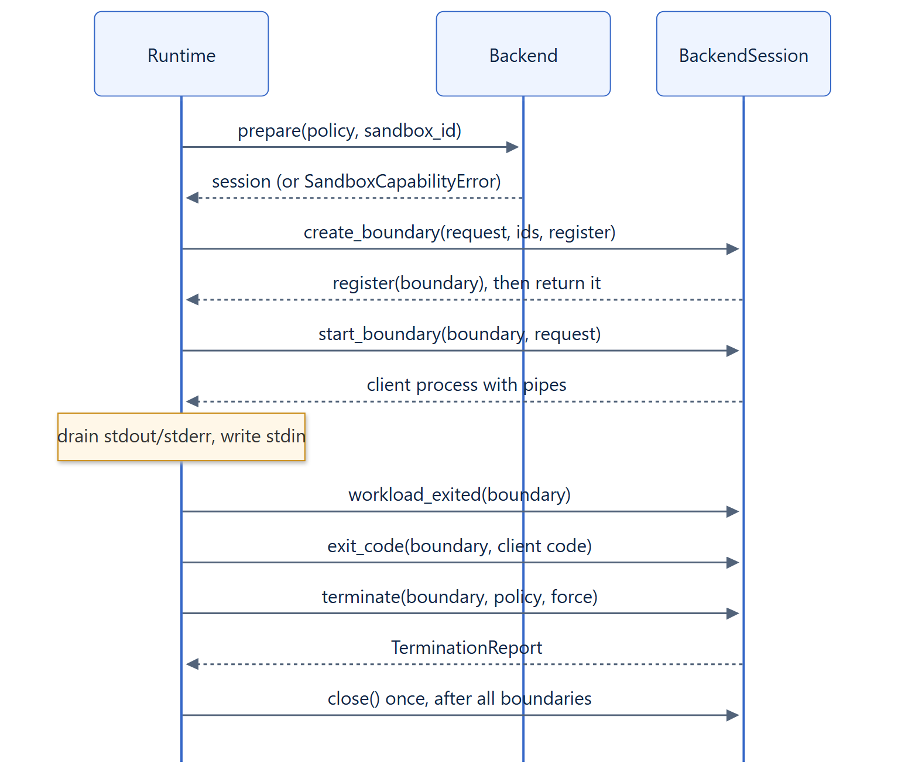

# 07. Backend contracts

## Overview

A backend turns a `SandboxPolicy` into owned, identity-bound execution boundaries. The
runtime owns ordering, admission, deadlines, output streaming, artifact integrity and
error composition; the backend owns enforcement and observation. Every extension
point is an abstract base class, constructed by the application and passed
explicitly. There are no entry points, plugin registries or automatic discovery.



## Backend

```text
class Backend(ABC):
    async discover() -> BackendReport
    async prepare(policy: SandboxPolicy, sandbox_id: str) -> BackendSession
```

`discover()` returns capability evidence for the current host. `prepare()` validates
the policy, rejects anything it cannot enforce with `SandboxCapabilityError`, and
returns a session that owns instance-wide resources such as a workspace or instance
budget.

## BackendSession

```text
class BackendSession(ABC):
    backend_name: str
    workspace_path -> str | None                        # default None
    async create_boundary(request, sandbox_id, execution_id, register) -> Boundary
    async start_boundary(boundary, request) -> asyncio.subprocess.Process
    async workload_exited(boundary) -> None
    async exit_code(boundary, client_exit_code) -> int
    async terminate(boundary, policy, force_requested: asyncio.Event) -> TerminationReport
    async close() -> None                               # default no-op
    # optional; the defaults raise SandboxCapabilityError
    async export_workspace(destination) / import_workspace(source)
    async checkpoint(boundary, destination)
    async restore_boundary(source, sandbox_id, execution_id, register) -> Boundary
    async snapshot_boundary(boundary, destination) / import_root(source)
```

Contract rules:

- `create_boundary` allocates an unstarted boundary and calls `register` as soon as
  the backend may have accepted the allocation, including when it is cancelled, so
  the runtime can always clean it up.
- `start_boundary` returns the attached client process with stdout and stderr pipes,
  and stdin when the request supplies input. A failed start reaps any local client
  it did not return.
- `workload_exited` ends the boundary when descendants could hold inherited output
  pipes, so draining reaches end of file.
- `exit_code` returns the authoritative workload exit code, not the client's.
- `terminate` stops, verifies emptiness and releases the boundary, usually through
  `terminate_boundary()`. It raises `TerminationVerificationError` when it cannot
  verify the result.
- `close` runs exactly once, after every boundary was terminated.
- Optional features fail closed: the base class raises `SandboxCapabilityError`.

`Boundary` is a mutable dataclass holding `boundary_id`, `name`, `sandbox_id`,
`execution_id`, `start_requested` and `restore_source`.

## Supporting extension points

| Class | Methods | Purpose |
| --- | --- | --- |
| `TerminationDriver` | `observe()`, `signal(*, force)`, `remove()`, `exists()` | Identity-bound control used by `terminate_boundary()`; see the [termination engine](11-termination-engine.md) |
| `CommandRunner` | `spawn(argv, *, stdin)` | Starts engine clients for Podman, Docker and Kubernetes; `SubprocessRunner` is the default |
| `ArtifactStore` | `publish`, `fetch(..., max_bytes)`, `exists`, `delete` | Stores snapshots and checkpoints; see [snapshots](13-snapshot-architecture.md) |
| `EventSink` | `emit(event)` | Receives redacted lifecycle events; see [observability](18-observability.md) |

A custom `CommandRunner` can wrap engine clients, for example to add auditing or to
reach an engine through a trusted tunnel. It receives argv vectors and must not
interpret them through a shell.

## Built-in backends

| Class | `backend_name` | Boundary |
| --- | --- | --- |
| `LinuxNamespaceBackend` | `linux-namespaces` | Namespaces and a delegated cgroup |
| `WindowsJobBackend` | `windows-job` | A Job Object |
| `WindowsAppContainerBackend` | `windows-appcontainer` | An AppContainer process in a Job Object |
| `PodmanBackend` | `podman` | A labelled container |
| `DockerBackend` | `docker` | A labelled container through the Docker API |
| `KubernetesBackend` | `kubernetes` | One Pod per execution |

The six built-in backends ship with the package. See the
[backend guides](../backends/linux.md) and the
[custom backend guide](../guides/custom-backend.md).
