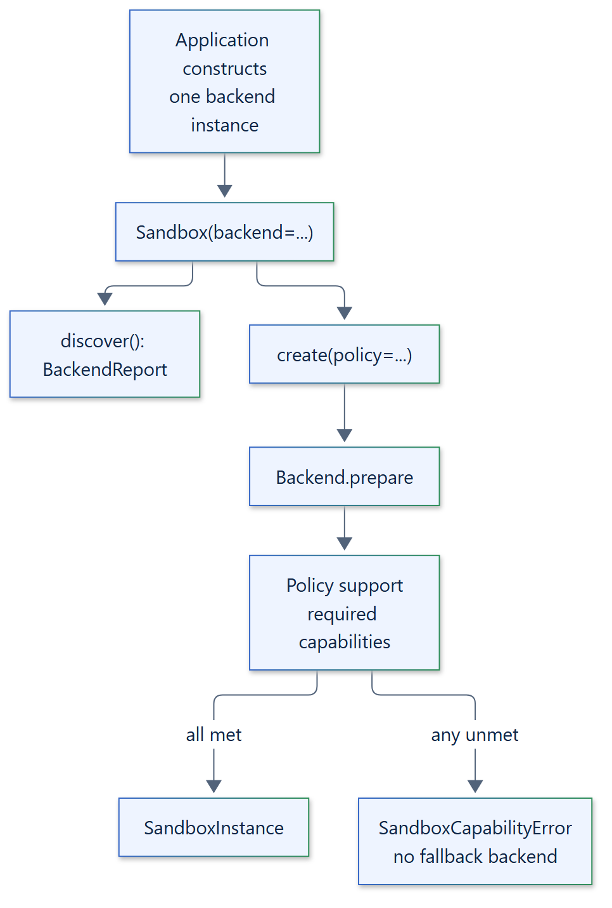

# 08. Backend resolution

## Explicit selection

The application constructs one backend and passes it to `Sandbox(backend=...)`. There
is no automatic backend selection, ranking, fallback chain or plugin discovery. A
backend that cannot enforce the policy rejects it; Isolattice never retries on a
different or weaker backend.



## Choosing a backend

Applications that support several environments choose explicitly, for example by
configuration, and can call `discover()` first to check availability and evidence:

```python
async with Sandbox(backend=configured_backend) as sandbox:
    (report,) = await sandbox.discover()
    if not report.available:
        raise RuntimeError(report.error)
    instance = await sandbox.create(policy=policy)
```

Discovery informs the choice; it does not replace the checks in `prepare()`. A
different policy or backend means a different `Sandbox` or instance, chosen by the
application.

| Environment | Backend |
| --- | --- |
| Linux host with user namespaces and a delegated cgroup | `LinuxNamespaceBackend` |
| Windows, Job Object containment only | `WindowsJobBackend` |
| Windows, AppContainer filesystem and network isolation | `WindowsAppContainerBackend` |
| Podman, rootless or rootful | `PodmanBackend` |
| Docker Engine API | `DockerBackend` |
| Kubernetes namespace | `KubernetesBackend` |
| macOS host | `PodmanBackend` (Podman machine or remote engine), `DockerBackend` or `KubernetesBackend`; native backend proposed |
| Remote engine | `PodmanBackend` over an `ssh://` connection, `DockerBackend` with a remote host, or `KubernetesBackend`; Isolattice remote service proposed |

## Rootful engines

Constructing a built-in backend and passing it to `Sandbox` is the only selection
step; there is no separate policy flag. Podman and Docker reject a rootful engine
unless the backend is constructed with `allow_rootful=True`.

See the [capabilities reference](../reference/capabilities.md) for the policy
combinations each backend accepts.
