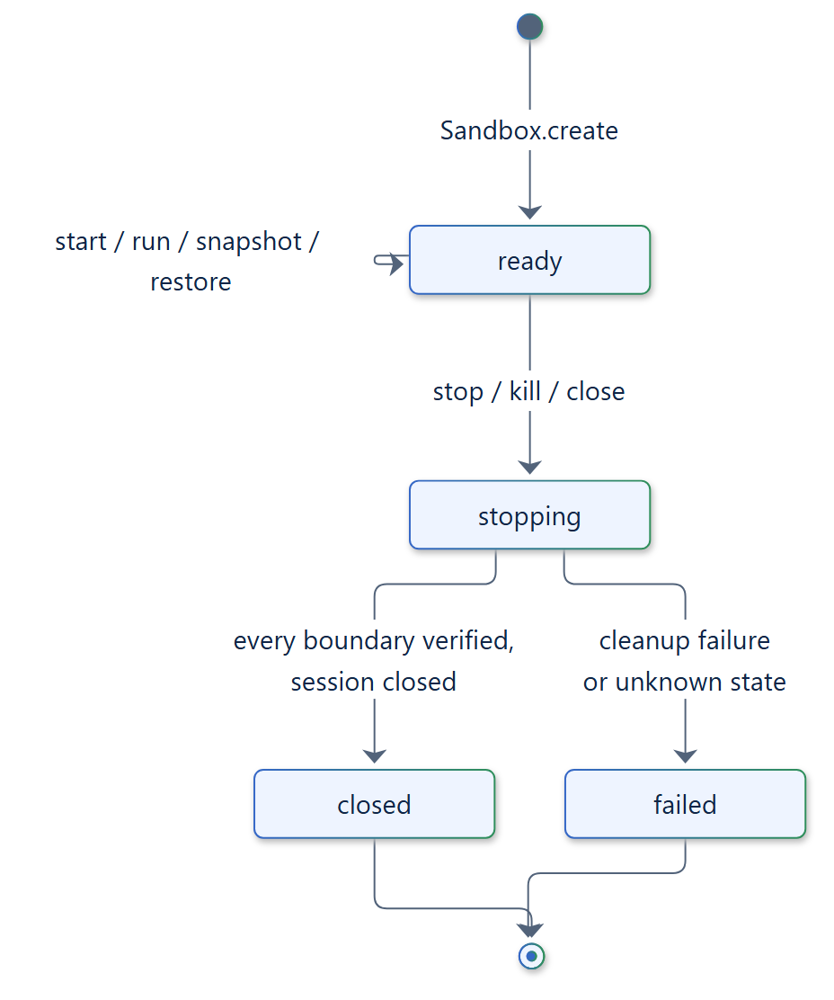
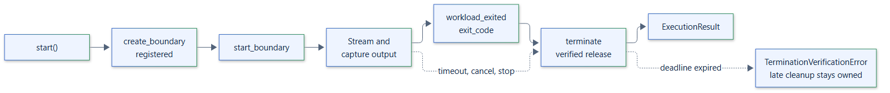

# 09. Lifecycle state machine

## Owners

| Owner | States | Transitions |
| --- | --- | --- |
| `Sandbox` | `open`, `closing`, `closed`, `failed` | `close()` or leaving the context closes every instance it created |
| `SandboxInstance` | `ready`, `stopping`, `closed`, `failed` | `stop()`, `kill()` or `close()` move from `ready` to `stopping` |
| `ExecutionHandle` | running, cleaning up, finished | Ends with a verified termination report or an error |

Operations on an owner that is not in the required state raise `SandboxStateError`.

## Instance lifecycle

- `Sandbox.create()` returns an instance only after `prepare()` and any snapshot
  imports succeeded. Otherwise the session is closed and the instance never exists.
- In `ready`, the instance admits `start()`, `run()`, `snapshot()` and `restore()`.
  Admission and snapshots share a per-instance lock. `start()` raises
  `SandboxStateError` when `max_concurrent_executions` executions are active.
- `stop()`, `kill()` and `close()` start one owned stop task, shared by concurrent and
  repeated callers. It terminates every active execution, then closes the session.
  `kill()` also sets the force flag of each execution, skipping the graceful phase.
- The instance becomes `closed` when every boundary was verified and released and
  the session closed. Otherwise it becomes `failed` and the caller receives a
  `BaseExceptionGroup` of every cleanup failure; a `SANDBOX_CLEANUP_FAILED` event is
  emitted.
- If late cleanups are still pending after their deadline, the session and its
  instance-wide resources are retained instead of being released over a live
  boundary, and the stop reports a `TerminationVerificationError`.

## Execution lifecycle

1. `create_boundary` allocates and registers the boundary before any start.
2. `start_boundary` starts the workload and its attached client process.
3. Both output streams are drained concurrently in 64 KiB reads into bounded captures,
   or into the `output()` queue with backpressure.
4. `workload_exited` and `exit_code` determine the authoritative exit code.
5. `terminate` verifies an empty boundary and releases it. This runs on success,
   failure, timeout, cancellation and stop.

The deadline is `request.timeout`, or `policy.execution_timeout` when unset. On expiry
the boundary is terminated and `SandboxTimeoutError` carries the report.
`cancel(force=False)` terminates only that execution and returns its report.

## Cleanup deadline

`TerminationPolicy.cleanup_deadline` starts when cleanup begins. When it expires,
the runtime emits `TERMINATION_UNKNOWN`, keeps the cleanup task running as an owned
late cleanup, and raises `TerminationVerificationError` with state `unknown`. The
late cleanup later emits `LATE_CLEANUP_FINISHED` or `LATE_CLEANUP_FAILED`, and
`SandboxInstance.pending_late_cleanups` counts the outstanding ones.

## Cancellation

Cleanup runs in owned tasks. Cancelling a waiter does not cancel cleanup: the waiter
waits for cleanup to finish or its deadline to pass, then re-raises the cancellation
together with any cleanup failure. Each `Sandbox` belongs to one event loop.
