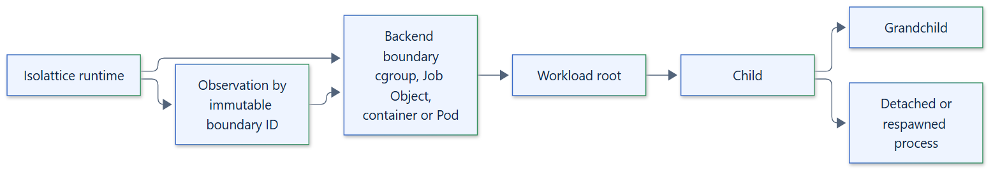

# 10. Process containment

## Principle

A workload's process tree belongs to a backend boundary with an authoritative,
immutable identity. Termination is decided by observing that boundary, never by a
PID, a process name, recursive PID walking or the exit of the direct child.
Descendants that detach, daemonize or respawn remain inside the boundary until it
is verified empty and released.

## Boundaries per backend

| Backend | Boundary identity | Containment and observation |
| --- | --- | --- |
| Linux namespaces | An owned cgroup v2 leaf under a delegated subtree | New PID namespace; `cgroup.kill` ends the tree and `cgroup.events` reports when it is empty |
| Windows Job Object | A nested execution Job Object in an instance job | The process is assigned to the job before it runs; job accounting reports active processes |
| Windows AppContainer | An execution Job Object nested in the instance job | Created inside the AppContainer and both jobs by one `CreateProcessW` call in a launcher |
| Podman, Docker API | A container ID labelled `io.isolattice.sandbox` | Engine inspection by ID; the container's PID namespace and cgroup hold the tree |
| Kubernetes | A Pod name with its UID | UID-preconditioned deletion; the API server must report the Pod gone |
| macOS | Proposed | No backend; Seatbelt alone has no process-tree boundary |
| Remote | Proposed | No backend |

## Launch

- Linux starts each execution through a trusted launcher that enters fresh user,
  mount, PID, network, IPC, UTS and cgroup namespaces, joins the cgroup leaf, pivots
  into a read-only root and runs the workload as uid 65534 with `no_new_privs`,
  Landlock, seccomp and no capabilities.
- Windows creates the workload inside its jobs through
  `PROC_THREAD_ATTRIBUTE_JOB_LIST`, so it never runs outside its boundary, and
  inherits only the three standard handles.
- Container backends verify the kernel-visible isolation and limits from inside the
  boundary before the workload is executed, and refuse to run it otherwise.

## Guarantees and limits

- Verified termination means the backend observed the boundary empty or gone and
  confirmed the release of its resources. An `unknown` state is a failure.
- Windows Job Object containment is not a security boundary: the workload keeps the
  caller's identity and its filesystem, registry, network and IPC access.
- Containment does not protect against a compromised kernel, engine or cluster, and
  privileged or host-mounted container configurations are not supported.

See [process escape prevention](../security/process-escape-prevention.md) and the
[process tree termination guide](../guides/process-tree-termination.md).
