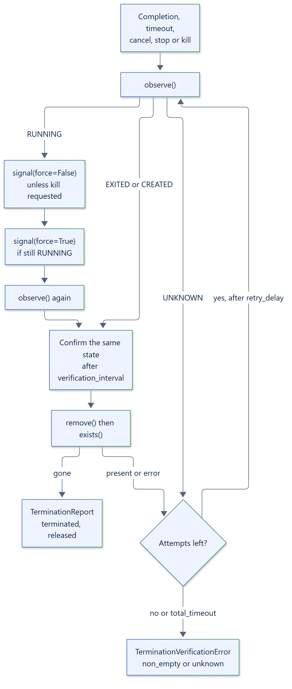

# 11. Termination engine

## Purpose

`terminate_boundary(driver, policy, force_requested)` is the shared algorithm that
stops a boundary, verifies it is empty and releases its resources. Backends implement
a `TerminationDriver` for their boundary identity and call it from
`BackendSession.terminate()`.



## Driver contract

```text
class TerminationDriver(ABC):
    boundary_id: str
    start_requested: bool        # a start was requested, so a delayed start must be prevented
    signal_releases: bool        # a successful signal also releases the boundary
    async observe() -> Observation
    async signal(*, force: bool) -> None
    async remove() -> None
    async exists() -> bool

Observation(state: BoundaryState, exit_code: int | None = None, detail: str = "")
BoundaryState: CREATED, RUNNING, EXITED, ABSENT, UNKNOWN
```

Every method acts on the immutable boundary identity. A `SandboxBackendError` from a
driver is recorded as a note and treated as `UNKNOWN`; it never counts as success.

## Algorithm

Each attempt, within `total_timeout` overall:

1. Observe the boundary.
2. If it is `RUNNING`, send a graceful signal unless force was requested, and wait up
   to `graceful_timeout`; a force request during the wait ends it early. If it is still
   running, send a forced signal and wait up to `force_timeout`.
3. If it is `EXITED` or `CREATED`, wait `verification_interval` and observe again. Only
   the same state twice counts as quiescent. An `ABSENT` boundary counts only after a
   removal or a releasing signal was acknowledged.
4. Call `remove()`, then `exists()`. The boundary counts as released only when `exists()`
   reports it gone.
5. Otherwise wait `retry_delay` and start the next attempt.

A `CREATED` boundary with `start_requested` is removed directly, which prevents a
delayed start. If every attempt fails, or `total_timeout` expires,
`TerminationVerificationError` carries a report with state `non_empty` (last seen
running) or `unknown`.

## Policy

| `TerminationPolicy` field | Default | Meaning |
| --- | --- | --- |
| `attempts` | `3` | Full observe, stop and release attempts |
| `graceful_timeout` | `5.0` | Seconds to wait after the graceful signal; `0` allowed |
| `force_timeout` | `2.0` | Seconds to wait after the forced signal |
| `verification_interval` | `0.5` | Polling interval and confirmation delay |
| `retry_delay` | `1.0` | Delay between attempts; `0` allowed |
| `total_timeout` | `60.0` | Bound on `terminate_boundary()` |
| `cleanup_deadline` | `90.0` | Runtime bound on the whole cleanup of one execution |

## Runtime integration

The runtime calls `terminate()` for every execution after completion, timeout,
cancellation, `stop()` and `kill()`. `kill()` and `cancel(force=True)` set
`force_requested`. When `cleanup_deadline` expires, the runtime raises
`TerminationVerificationError` with state `unknown`, emits `TERMINATION_UNKNOWN` and
keeps the cleanup running as an owned late cleanup; see the
[lifecycle](09-lifecycle-state-machine.md).

## Report

`TerminationReport` records `boundary_id`, `attempts`, `observations`, `state`
(`terminated`, `non_empty` or `unknown`), `resources_released` and `notes`. Only
`terminated` with `resources_released=True` is success.
