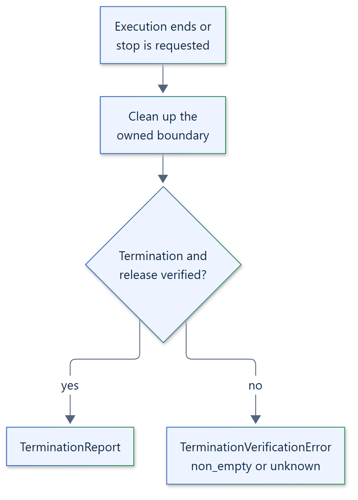

# 11. Termination engine

## Purpose

`terminate_boundary(driver, policy, force_requested)` is the shared algorithm that
stops a boundary, verifies it is empty and releases its resources. Backends implement
a `TerminationDriver` for their boundary identity and call it from
`BackendSession.terminate()`.



## Driver contract

```text
class TerminationDriver(ABC):
    boundary_id: str
    start_requested: bool        # a start was requested, so a delayed start must be prevented
    signal_releases: bool        # a successful signal also releases the boundary
    async observe() -> Observation
    async signal(*, force: bool) -> None
    async remove() -> None
    async exists() -> bool

Observation(state: BoundaryState, exit_code: int | None = None, detail: str = "")
BoundaryState: CREATED, RUNNING, EXITED, ABSENT, UNKNOWN
```

Every method acts on the immutable boundary identity. A `SandboxBackendError` from a
driver is recorded as a note and treated as `UNKNOWN`; it never counts as success.

## Algorithm

The helper can escalate a graceful stop to a forced stop and retry within the
configured limits. It uses evidence about the boundary, not the exit of the
initial process. A driver must not report a boundary as released while a pending
start might still launch a workload. If cleanup cannot be verified,
`TerminationVerificationError` carries a report with state `non_empty` (last seen
running) or `unknown`.

## Policy

| `TerminationPolicy` field | Default | Meaning |
| --- | --- | --- |
| `attempts` | `3` | Full observe, stop and release attempts |
| `graceful_timeout` | `5.0` | Seconds to wait after the graceful signal; `0` allowed |
| `force_timeout` | `2.0` | Seconds to wait after the forced signal |
| `verification_interval` | `0.5` | Polling interval and confirmation delay |
| `retry_delay` | `1.0` | Delay between attempts; `0` allowed |
| `total_timeout` | `60.0` | Bound on `terminate_boundary()` |
| `cleanup_deadline` | `90.0` | Runtime bound on the whole cleanup of one execution |

## Runtime integration

The runtime calls `terminate()` for every execution after completion, timeout,
cancellation, `stop()` and `kill()`. `kill()` and `cancel(force=True)` set
`force_requested`. When `cleanup_deadline` expires, the runtime raises
`TerminationVerificationError` with state `unknown`, emits `TERMINATION_UNKNOWN` and
keeps the cleanup running as an owned late cleanup; see the
[lifecycle](09-lifecycle-state-machine.md).

## Report

`TerminationReport` records `boundary_id`, `attempts`, `observations`, `state`
(`terminated`, `non_empty` or `unknown`), `resources_released` and `notes`. Only
`terminated` with `resources_released=True` is success.
