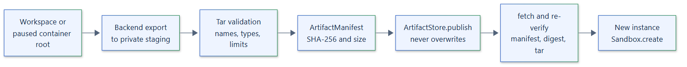

# 13. Snapshot architecture

## Kinds

| Kind | Created by | Restored by | Format | Backends |
| --- | --- | --- | --- | --- |
| Workspace snapshot | `SandboxInstance.snapshot(key)` | `Sandbox.create(workspace_snapshot=key)` | `tar` | Linux, Windows AppContainer, Podman |
| Container snapshot | `ExecutionHandle.snapshot_container(key)` | `Sandbox.create(container_snapshot=key)` | `rootfs-tar` | Podman |
| Execution checkpoint | `ExecutionHandle.checkpoint(key)` | `SandboxInstance.restore(key)` | `backend-checkpoint` | Rootful Podman; see [checkpoints](14-checkpoint-architecture.md) |

All kinds are implemented. A backend without the feature raises
`SandboxCapabilityError`; there is no emulation.



## Workspace snapshots

Workspace snapshots are cold. They require `workspace=True`, an instance in the
`ready` state and no active executions; the instance lock keeps new executions out
while `export_workspace()` writes an uncompressed tar into private staging. Restoring
populates the empty workspace of a new instance through `import_workspace()` before
the instance is returned.

## Container snapshots

`snapshot_container()` captures the root filesystem of a running execution while
the container is paused, so the archive is consistent, and leaves the execution
running. A new instance created with `container_snapshot=key` runs every execution
from that root through `import_root()`.

## Artifacts

An `ArtifactManifest` records `kind`, `backend`, `format`, `archive`, `sha256`, `size`
and `created_at`, serialized as canonical JSON of at most 64 KiB. The runtime seals
the manifest after export, publishes archive and manifest through the
`ArtifactStore`, and after every fetch verifies the key, kind, producing backend,
format, size and SHA-256 digest before any backend sees the archive.

Archive validation:

- At most 16 GiB and 1,000,000 tar members.
- Workspace archives reject absolute, traversing, backslash and drive-letter names,
  devices, FIFOs and other special files, and every member must pass
  `tarfile.data_filter`.
- Root filesystem archives require every hard link to name an earlier member.
- Keys are slash-separated segments of `[A-Za-z0-9._-]`, at most 512 characters,
  without leading `.` or `-`, trailing `.`, Windows device names or the
  `.manifest.json` suffix; see `validate_artifact_key()`.

## Stores

```text
class ArtifactStore(ABC):
    async publish(key, archive: Path, manifest: ArtifactManifest) -> None
    async fetch(key, destination: Path, *, max_bytes: int) -> ArtifactManifest
    async exists(key) -> bool
    async delete(key) -> bool
```

- `publish` never overwrites: an existing key raises `SandboxArtifactError`. The
  manifest is written last, so a key exists only when complete.
- `LocalArtifactStore(root)` publishes through exclusive files and hard links inside
  an existing root directory and rejects paths that leave it.
- `S3ArtifactStore` (extra `s3`) uses aiobotocore with conditional `If-None-Match: *`
  writes, bounded multipart uploads and a client per operation. Credentials are kept
  out of `repr`.
- `isolattice.testing.check_artifact_store(store, workdir)` checks a custom store
  against the contract and raises `ConformanceError`.

Staging uses private directories under `Sandbox(staging_directory=...)` or the system
temporary directory and is removed after each operation.

See the [snapshots guide](../guides/snapshots.md) and the [storage API](../api/storage.md).
