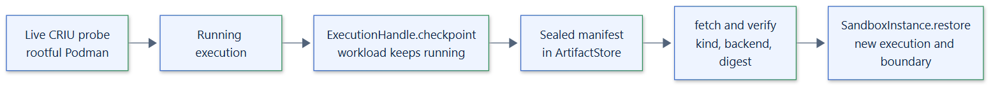

# 14. Checkpoint architecture

## Scope

Execution checkpoints capture a running process tree and restore it in a new
boundary. They are implemented only by `PodmanBackend` on a rootful
engine, using CRIU through `podman container checkpoint` and `restore`. Every other
backend raises `SandboxCapabilityError`.

## Preparation

- The Podman backend reports `CHECKPOINTS` as `LIMITED` on a rootful engine and
  `UNSUPPORTED` on a rootless one.
- An instance that will checkpoint must list `Capability.CHECKPOINTS` in
  `required_capabilities`. Podman accepts it at `LIMITED` and runs a live CRIU probe
  in `prepare()`; a failed probe rejects the policy.
- Checkpoints cannot be combined with a workspace, an instance budget or a writable
  root.

## Checkpoint

`ExecutionHandle.checkpoint(key)` requires a running execution. The backend dumps the
container while leaving it running, and the runtime seals an `EXECUTION_CHECKPOINT`
manifest with format `backend-checkpoint` and publishes it to the artifact store.

## Restore

`SandboxInstance.restore(key, *, timeout=None)` fetches the artifact, verifies key,
kind, producing backend, format, size and digest, and passes the verified file to
`restore_boundary()`. The result is a new `ExecutionHandle` with its own execution ID
and boundary, subject to the same admission limit, deadline and verified
termination as any execution. Output already delivered before the checkpoint is not
replayed.

## Limits

CRIU restores need a compatible kernel, CRIU version, engine and image on the
restoring host. A checkpoint contains process memory, so it must be treated as
sensitive as the workload's data. Moving a running execution between hosts is not provided.

See the [checkpoints guide](../guides/checkpoints.md).
