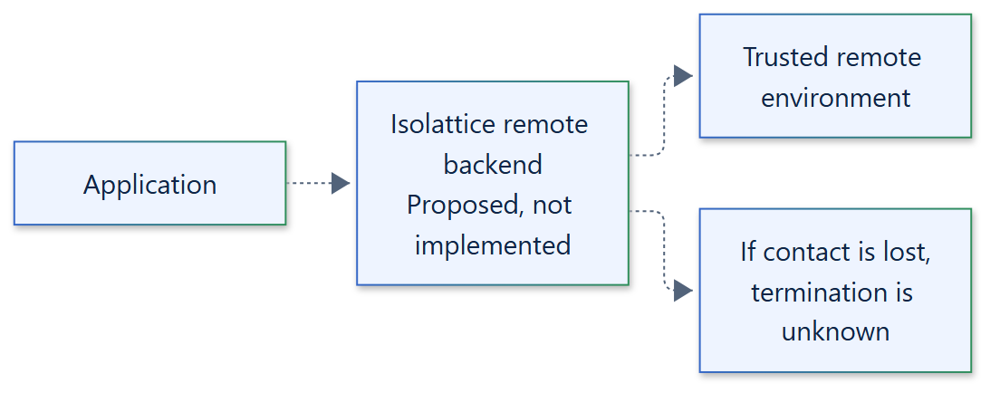

# 15. Remote backend protocol

!!! warning "Proposed"
    Remote execution is proposed. There is no remote backend, protocol, server or
    client in Isolattice, and no compatibility or availability is promised.

## Today

Applications that need execution on another host can use the implemented backends
against remote endpoints they already trust:

- `PodmanBackend(connection=...)` with a named Podman connection.
- `DockerBackend(host=...)` with an explicit Docker API endpoint.
- `KubernetesBackend(kubeconfig=..., context=..., namespace=...)` with a cluster.
- A custom `CommandRunner` that wraps the engine clients, for example to add
  auditing or a tunnel.

These keep local verified termination semantics because the engine or API server
remains the authoritative boundary identity. They do not add tenant authentication,
leases or orphan reconciliation beyond what the engine or cluster provides.

## Requirements for a remote design

A remote backend would need an architecture review and approval before
implementation. At minimum it must provide:

- Explicit endpoint trust, authorization and safe handling of workload data.
- Clear ownership, bounded output and a way to resolve uncertain outcomes without
  assuming a disconnected workload has stopped.
- Capability evidence for the remote host, not the client.

See the [remote backend page](../backends/remote.md) and the
[remote execution guide](../guides/remote-execution.md).
