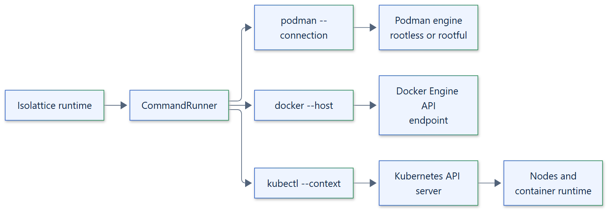

# 16. Container backend architecture

## Overview

`PodmanBackend`, `DockerBackend` and `KubernetesBackend` are implemented. They
drive the trusted engine clients `podman`, `docker` and `kubectl` through a
`CommandRunner` with bounded, cancellation-safe invocations and an explicit
connection, endpoint or context. Containers and Pods share the host or node
kernel, so kernel, engine, runtime or cluster exploits are out of scope.

## Common design

- **Explicit target.** Podman needs a named `connection`, Docker a `host` endpoint,
  Kubernetes a `kubeconfig`, `context` and `namespace`, each with an explicit
  `image`. Ambient defaults are not used.
- **Ownership labels.** Every resource carries `io.isolattice.sandbox` and execution
  labels, so cleanup acts only on owned resources by immutable ID.
- **Hardened configuration.** Containers run as uid 65534 with all capabilities
  dropped, `no-new-privileges`, a seccomp profile, private PID, IPC and UTS
  namespaces, no network, a read-only root by default and the requested memory, CPU
  and process limits.
- **Inspect, then verify inside.** After creation the backend inspects the engine's
  view and rejects any added mount, device, environment value, capability or
  weakened limit. A POSIX `sh` prelude then reads the kernel's view from inside the
  container and refuses to execute the workload unless every check passes.
- **Verified termination.** Termination drivers observe and remove the container or
  Pod by ID and confirm that the engine reports it gone.
- **Rootful opt-in.** Podman and Docker reject a rootful engine unless constructed
  with `allow_rootful=True`.

## Podman

Rootless and rootful engines are supported. Podman provides the widest feature set:
writable roots, size-capped scratch storage, persistent workspaces and workspace
snapshots, whole-container snapshots, and on rootful engines instance budgets through
pod cgroups and CRIU checkpoints. `DISK_LIMIT` cannot be combined with a writable
root or a workspace, and checkpoints cannot be combined with a workspace, an instance
budget or a writable root. Podman Desktop machines are reached through their Podman
connection; see the [Podman Desktop guide](../guides/podman-desktop.md).

## Docker API

`DockerBackend` targets any Docker Engine API endpoint and requires the engine to
report seccomp. It accepts only `network=NONE` and a read-only root, and rejects
workspaces and instance budgets. Its live tests run against Podman's
Docker-compatible API.

## Kubernetes

Each execution is one Pod in the configured namespace, with `restartPolicy: Never`,
no service account token, no service links, `runAsNonRoot`, a read-only root, all
capabilities dropped and the `RuntimeDefault` seccomp profile. The backend verifies
the admitted Pod and its kernel-visible limits before executing the workload.
Termination uses UID-preconditioned deletion and waits until the API server reports
the Pod gone. Kubernetes does not isolate the network by itself, so the policy must
state `network=ENABLED`; apply a `NetworkPolicy` in the namespace. It rejects
writable roots, workspaces and instance budgets. Live tests run on a kind cluster.

## Trust

The engine, its daemon, the container runtime, the cluster control plane and nodes
are trusted. A compromised engine or cluster, privileged containers, host mounts and
custom runtimes are outside the guarantees. See the backend pages for
[Podman](../backends/podman.md), [Docker](../backends/docker.md) and
[Kubernetes](../backends/kubernetes.md).
