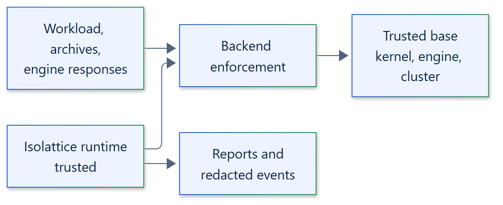

# 17. Security threat model

!!! warning "Shared-kernel boundaries"
    Container, namespace and AppContainer backends share the host or node kernel,
    and the Windows Job Object backend is not a security boundary. Use a VM or
    microVM boundary for hostile multi-tenant workloads.

## Trust boundaries

- **Untrusted:** the workload and everything it produces (output, exit codes,
  processes, files), artifact archives and manifests read back from a store, and
  responses from engines and clusters until validated.
- **Trusted:** the application and its policy, the Isolattice runtime, the selected
  backend code and its launchers, the host kernel, the container engine, the
  Kubernetes control plane and nodes, and the artifact store's access control.

## Threats and controls

| Threat | Implemented control | Residual risk |
| --- | --- | --- |
| Silent weakening of the requested policy | `prepare()` rejects anything it cannot enforce; required capabilities fail closed; weaker settings need explicit acknowledgement | A backend bug can misreport enforcement |
| Process escape from cleanup (detach, daemonize, fork storms) | Identity-bound boundaries; verified termination with repeated observation and release confirmation; `unknown` is a failure | Kernel or engine defects |
| PID reuse | No PID-based identity; container IDs, Pod UIDs, cgroups and Job Objects | None known within the design |
| Engine misconfiguration or tampering with the requested spec | Inspection of the created container or Pod; in-boundary kernel checks before exec | A compromised engine can lie consistently |
| Privilege escalation | uid 65534, all capabilities dropped, `no_new_privs`, seccomp; Linux adds Landlock; AppContainer uses a lowbox token | Kernel vulnerabilities; Windows Job Object is not a security boundary |
| Network access | `network=NONE` enforced where supported; other settings require explicit `ENABLED` | Kubernetes and Windows Job Object do not isolate the network |
| Resource exhaustion | Memory, CPU and process limits, instance budgets, scratch caps, bounded output and queues, deadlines | Limits vary by backend; host-wide contention remains |
| Malicious archives | Size and member limits, path and type validation, `tarfile.data_filter`, manifest and SHA-256 verification, no overwrite | A store that serves different bytes than it accepted is detected, not prevented |
| Secret leakage | Environment starts empty; events and reports never contain argv, environment values, stdin or output; S3 credentials hidden from `repr` | Workloads can print what they are given |
| Cleanup lost on cancellation or crash | Owned cleanup tasks, hard `cleanup_deadline`, late cleanup tracking, labelled resources for operator reconciliation | A killed host process cannot clean up; labels allow manual cleanup |

## Out of scope

Hypervisor-grade isolation, side channels, a compromised kernel, engine, cluster or
artifact store, privileged containers, host mounts and custom runtimes. The macOS and
remote backends are proposed and have no threat model of their own yet.

See the [security model](../concepts/security-model.md), the
[guarantees](../security/guarantees.md), the
[platform limitations](../security/platform-limitations.md) and the
[security threat model](../security/threat-model.md).
