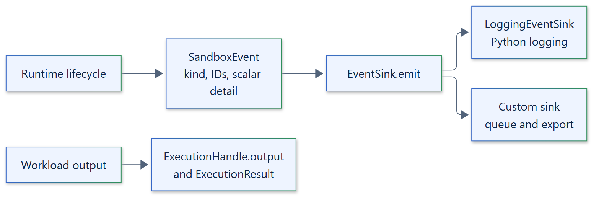

# 18. Observability

## Model

The runtime reports lifecycle transitions as `SandboxEvent` values to one `EventSink`
per `Sandbox`. Workload output never flows through events; it is available only
through `ExecutionHandle.output()` and `ExecutionResult`.



## Events

```text
SandboxEvent(kind: EventKind, sandbox_id: str, backend: str,
             execution_id: str | None = None,
             detail: Mapping[str, str | int | float | bool | None] = {},
             timestamp: datetime = now(UTC))
  is_warning -> bool
```

| `EventKind` | Value | Detail | Warning |
| --- | --- | --- | --- |
| `SANDBOX_CREATED` | `sandbox.created` | | |
| `SANDBOX_CLOSED` | `sandbox.closed` | | |
| `SANDBOX_CLEANUP_FAILED` | `sandbox.cleanup-failed` | `failures` | Yes |
| `EXECUTION_STARTED` | `execution.started` | `restored` for restores | |
| `EXECUTION_FINISHED` | `execution.finished` | `exit_code` | |
| `EXECUTION_FAILED` | `execution.failed` | `error` (exception type) | |
| `TERMINATION_UNKNOWN` | `termination.unknown` | `phase` | Yes |
| `LATE_CLEANUP_FINISHED` | `late-cleanup.finished` | `released` | Yes |
| `LATE_CLEANUP_FAILED` | `late-cleanup.failed` | `error` (exception type) | Yes |
| `ARTIFACT_PUBLISHED` | `artifact.published` | `key`, `artifact_kind`, `size` | |
| `ARTIFACT_RESTORED` | `artifact.restored` | `key`, `artifact_kind`, `size` | |

Detail values are scalars. Events never contain argv, environment values, stdin,
output or exception messages.

## Sinks

```text
class EventSink(ABC):
    emit(event: SandboxEvent) -> None      # synchronous, on the event loop
LoggingEventSink(logger: logging.Logger | None = None)
```

- `emit` runs on the event loop and must not block. A sink that exports should
  buffer and ship from its own task or thread.
- `LoggingEventSink` is the default. It logs warnings at `WARNING` and other events at
  `INFO`, with the event in the `isolattice_event` extra.
- An exception from a sink is logged and suppressed; observability never changes a
  lifecycle outcome.

## Reports

`TerminationReport`, `BackendReport` and `ArtifactManifest` are the evidence for
individual operations and are returned to the caller.

## Proposed

OpenTelemetry and metrics exporters are proposed. Applications can build them today
as an `EventSink`. See the [events reference](../reference/events.md) and the
[operations observability guide](../operations/observability.md).
