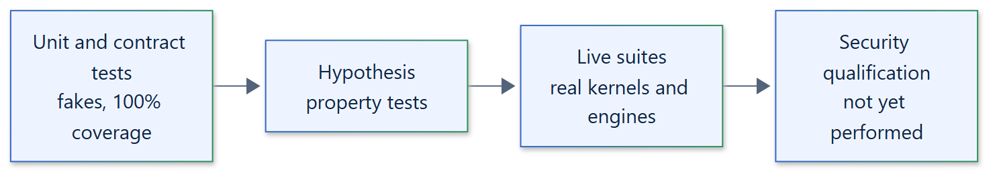

# 20. Testing strategy

## Principles

- Tests use pytest for examples and Hypothesis for properties.
- A unit test with a fake backend proves protocol behavior only. Enforcement claims
  need live evidence on a real kernel, engine or cluster; a skipped live test is not
  evidence.
- Every documented feature has unit tests, a runnable example and, where it enforces
  anything, a live suite.



## Unit suite

`tests/unit` runs on every platform without engines or privileges, under
`filterwarnings = error`. Its coverage combines with every live suite under
one branch-coverage gate (`fail_under = 87`, the verified combined floor); see
[coverage gate](../development/testing.md#coverage-gate).

| Area | Tests |
| --- | --- |
| Runtime | Lifecycle, admission, streaming bounds, deadlines, cancellation, grouped cleanup failures, late cleanup |
| Termination | `terminate_boundary()` against scripted drivers: escalation, confirmation, release, retries, `unknown` |
| Models and properties | Validation and Hypothesis properties for policies, requests, keys, manifests and archives |
| Backend contracts | Per-backend command, inspection and policy tests with fake runners and platform fakes |
| Artifacts | Sealing, verification, tar validation, local store and S3 store behavior |
| Extension points | Custom `Backend`, `ArtifactStore`, `EventSink` and `CommandRunner` implementations |
| Repository | Examples, documentation and skill validation, live-skip checks |

Hypothesis profiles are selected with `HYPOTHESIS_PROFILE`: `default`, `ci`
(300 examples) and `thorough` (2,000 examples).

## Live suites

`tests/integration` exercises real enforcement. Each suite skips with a reason when
its environment is not configured, and CI runs `scripts/check_live_skips.py` so an
unexpected skip fails the job.

| Suite | Environment |
| --- | --- |
| Linux namespaces | `ISOLATTICE_TEST_LINUX_CGROUP_ROOT`, a delegated cgroup v2 subtree |
| Windows Job Object, AppContainer | A Windows host |
| Podman (rootless, resources, rootful, container snapshots) | `ISOLATTICE_TEST_PODMAN_CONNECTION`/`_IMAGE`, `ISOLATTICE_TEST_PODMAN_RESOURCE_*`, `ISOLATTICE_TEST_PODMAN_ROOTFUL_*` |
| Docker API | `ISOLATTICE_TEST_DOCKER_HOST`/`_IMAGE` (optional `_EXECUTABLE`, `_ROOTFUL`); run against Podman's Docker-compatible API |
| Kubernetes | `ISOLATTICE_TEST_KUBERNETES_KUBECONFIG`/`_CONTEXT`/`_NAMESPACE`/`_IMAGE`; run on a kind cluster |
| S3 store | `ISOLATTICE_TEST_S3_ENDPOINT`/`_BUCKET`/`_ACCESS_KEY_ID`/`_SECRET_ACCESS_KEY` |

Live suites cover escape attempts (detached and respawning descendants), network and
filesystem denial, limits, verified cleanup with no owned resources left behind,
snapshots and checkpoints. `tests/skill` validates the agent skills.

## Validation commands

```text
uv run ruff check .
uv run ruff format --check .
uv run pyrefly check
uv run pytest tests/unit
uv run zensical build --strict
uv run python scripts/check_site_links.py
uv run python scripts/validate_repository.py
node scripts/render-diagrams.mjs --check
markdownlint-cli2
```

Pyrefly also runs with `--python-platform linux` and `--python-platform darwin`.

## Qualification

Passing tests show that the implemented behavior works on the tested hosts. They are
not a security qualification; no backend is qualified for hostile code. See
[development testing](../development/testing.md).
