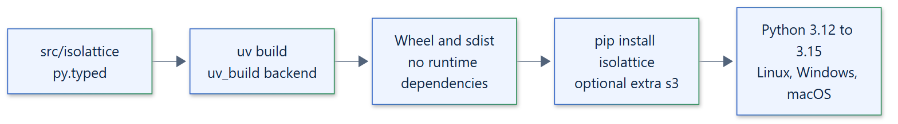

# 21. Packaging and distribution

## Package

| Property | Value |
| --- | --- |
| Distribution name | `isolattice` |
| Version | `0.1.0` (beta) |
| Build backend | `uv_build>=0.13.7,<0.14` |
| Source layout | `src/isolattice`, with `py.typed` |
| Python | `>=3.12`; classifiers for 3.12, 3.13, 3.14 and 3.15 |
| Runtime dependencies | None |
| License | Apache-2.0 |



## Extras

| Extra | Installs | Enables |
| --- | --- | --- |
| `s3` | `aiobotocore>=3.10.0,<4` | `S3ArtifactStore` |
| `all` | `isolattice[s3]` | Every optional feature |

```text
pip install isolattice
pip install "isolattice[s3]"
```

Backends need no extra. They use the standard library, operating system interfaces
and the engine clients (`podman`, `docker`, `kubectl`) installed on the host.

## Build

```text
uv build
```

`uv build` produces a wheel and a source distribution with the `uv_build` backend.
Development dependencies live in dependency groups (`test`, `lint`, `types`, `docs`,
and `dev`, the default), not in extras, so they never reach users.

## Platforms

The pure-Python wheel installs on Linux, Windows and macOS. Backend availability
depends on the host: the Linux and Windows backends need their operating system, and
container backends need a reachable engine or cluster. On macOS only the container
backends are usable; a native macOS backend is proposed. CI runs the core suite on
every GitHub-hosted Linux, Windows and macOS image with Python 3.12 to 3.15, and on
other Linux distributions and the BSDs; see
[tested platforms](../reference/tested-platforms.md).

## Release

Publishing is a manual maintainer step, not a CI workflow, and follows the
validation in the [testing strategy](20-testing-strategy.md). A version number never
implies protection beyond each backend's documented threat model.
See the [installation guide](../getting-started/installation.md) and the
[changelog](https://github.com/smuniharish/isolattice/blob/main/CHANGELOG.md).
