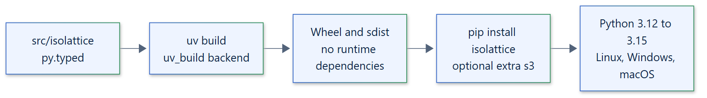

# 21. Packaging and distribution

## Package

| Property | Value |
| --- | --- |
| Distribution name | `isolattice` |
| Version | `0.1.1` (beta) |
| Build backend | `uv_build>=0.13.9,<0.14` |
| Source layout | `src/isolattice`, with `py.typed` |
| Python | `>=3.12`; classifiers for 3.12, 3.13, 3.14 and 3.15 |
| Runtime dependencies | None |
| License | Apache-2.0 |



## Extras

| Extra | Installs | Enables |
| --- | --- | --- |
| `s3` | `aiobotocore>=3.10.0,<4` | `S3ArtifactStore` |
| `all` | `isolattice[s3]` | Every optional feature |

```text
pip install isolattice
pip install "isolattice[s3]"
```

Backends need no extra. They use the standard library, operating system interfaces
and the engine clients (`podman`, `docker`, `kubectl`) installed on the host.

## Build

```text
uv build
```

`uv build` produces a wheel and a source distribution with the `uv_build` backend.
Development dependencies live in dependency groups (`test`, `lint`, `types`, `docs`,
and `dev`, the default), not in extras, so they never reach users.

## Platforms

The pure-Python wheel installs on Linux, Windows and macOS. Backend availability
depends on the host: the Linux and Windows backends need their operating system, and
container backends need a reachable engine or cluster. On macOS only the container
backends are usable; a native macOS backend is proposed. CI runs the core suite on
every GitHub-hosted Linux, Windows and macOS image with Python 3.12 to 3.15, and on
other Linux distributions and the BSDs; see
[tested platforms](../reference/tested-platforms.md).

## Release

Only the maintainer publishes distributions, creates release tags and publishes
GitHub releases. CI may validate packages but does not publish to PyPI or use
Trusted Publishing.

1. Check out the intended release commit in a clean worktree. Confirm the
   version with `uv version --short`, reconcile it with the changelog, and
   review existing CI and [security reporting requirements](../security/threat-model.md).
2. With a fresh output directory, build both distributions and validate their
   package metadata and rendered README without executing a test suite:

   ```text
   uv build --out-dir dist
   uvx twine@7.0.0 check --strict dist/*
   ```

3. Inspect the wheel with `python -m zipfile -l <wheel>` and the source
   archive with `python -m tarfile -l <sdist>`. Compare wheel `METADATA`
   and source `PKG-INFO` with `pyproject.toml`: name, version, Python support,
   license and optional requirements. Confirm that package sources, `py.typed`,
   and the license are present, with no credentials or local build files.
4. When ready to release, the maintainer manually uploads only those inspected
   files with `uvx twine@7.0.0 upload <wheel> <sdist>`, using a project-scoped
   PyPI API token supplied securely at the prompt. Verify the files and version
   on PyPI, then create the matching `v<version>` tag and GitHub release
   manually against the verified commit, using the changelog for the notes.

A version number never implies protection beyond each backend's threat model.
See the [installation guide](../getting-started/installation.md) and the
[changelog](https://github.com/smuniharish/isolattice/blob/main/CHANGELOG.md).
