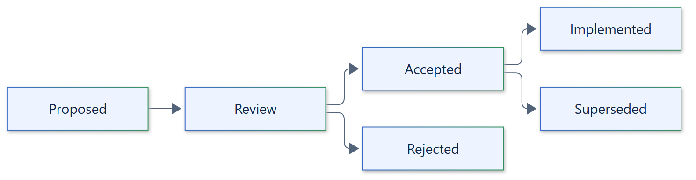

# 22. Architecture decision records

## Workflow

The register below records each architecture decision and its status. An accepted
decision is a design constraint; it is not proof of implementation or of security.
Implementation status is tracked in the
[feature coverage](../development/feature-coverage.md) ledger.

A new or changed decision records:

- context and the problem to solve;
- maintained libraries and operating system primitives considered, and alternatives;
- the decision and its consequences for guarantees, capability reports and failure
  modes;
- validation: unit, property and live tests, and examples.

Changes to required policy semantics or containment identity need coordinated
updates to the API, capability reports, tests, examples and documentation. New
subsystems and new runtime dependencies need an architecture review and approval
before implementation; see the [architecture review](../development/architecture-review.md).

## Statuses

| Status | Meaning |
| --- | --- |
| Proposed | Under consideration; nothing is implemented |
| Accepted | Approved design constraint |
| Implemented | Accepted and implemented with tests, examples and live evidence; never a claim of protection against kernel, engine or cluster exploits |
| Superseded | Replaced by a later decision |
| Rejected | Considered and declined |

## Register

| ID | Status | Decision |
| --- | --- | --- |
| ADR-001 | Implemented | One portable async API; enforcement is backend-specific; no synchronous execution API |
| ADR-002 | Superseded by ADR-007 | A documentation-only foundation stage before any runtime |
| ADR-003 | Implemented | Required guarantees fail closed; weaker settings need explicit policy acknowledgement; a backend is selected by constructing it and passing it to `Sandbox`, with no separate opt-in flag |
| ADR-004 | Accepted | Apache-2.0 license; no invented identity metadata |
| ADR-005 | Implemented | Zensical documentation site with mkdocstrings-python API reference and pre-rendered Mermaid diagrams |
| ADR-006 | Implemented | Frozen, validated dataclass models; no mandatory validation framework |
| ADR-007 | Implemented | Owned asyncio coordinators (`Sandbox`, `SandboxInstance`, `ExecutionHandle`); no global mutable registry |
| ADR-008 | Implemented | Authoritative boundary identity, confirmed emptiness and verified release before `terminated` |
| ADR-009 | Implemented | Extension points are abstract base classes passed as explicit instances; no entry points or plugin registry |
| ADR-010 | Implemented | Workload output is separate from redacted events; bounded queues and captures with truncation flags |
| ADR-011 | Implemented | Podman and Docker are distinct backends; Kubernetes is an independent Pod backend |
| ADR-012 | Superseded by ADR-018 | Use an async Kubernetes client library |
| ADR-013 | Proposed | Remote execution with server leases and durable idempotency; no transparent failover after acceptance |
| ADR-014 | Implemented | Cold workspace snapshots, container snapshots and live checkpoints are distinct kinds and formats |
| ADR-015 | Implemented | Explicit Podman connection and image; one owned container per execution |
| ADR-016 | Implemented | Rootless by default; rootful engines need `allow_rootful=True`, never automatic fallback; limits verified inside the boundary before exec |
| ADR-017 | Implemented | Allocation and start are cancellation-safe handoffs; accepted allocations are registered and unreturned clients reaped; cleanup has a hard `cleanup_deadline` with owned late cleanup |
| ADR-018 | Implemented | Kubernetes through the `kubectl` client and a `CommandRunner`, with UID-preconditioned deletion; no Kubernetes client dependency |
| ADR-019 | Implemented | Native backends use the standard library and `ctypes` with trusted launchers: Linux namespaces with a delegated cgroup, Windows Job Objects and AppContainers |
| ADR-020 | Implemented | Artifacts are sealed with SHA-256 manifests, never overwritten and verified after every fetch; S3 support is the optional `s3` extra using aiobotocore |
| ADR-021 | Implemented | Lifecycle events go to one synchronous, non-blocking `EventSink`; sink failures never change outcomes |
| ADR-022 | Proposed | Native macOS backend; requires an authoritative containment and termination identity |
| ADR-023 | Proposed | Framework integrations and OpenTelemetry or metrics exporters |

## Open questions

1. macOS containment and termination identity; unsupported until proven.
2. Remote authentication, tenant scope, durable ownership and lease clocks.
3. Security qualification criteria for any backend before hostile workloads.
4. Windows broker and service exposure for AppContainer and restricted tokens.
5. Kubernetes node and container runtime verification beyond in-Pod kernel checks.
6. Artifact authenticity and encryption beyond SHA-256 integrity, and the CRIU
   restore compatibility matrix.
7. Public contract versioning for extension points.
